<p align="center">
  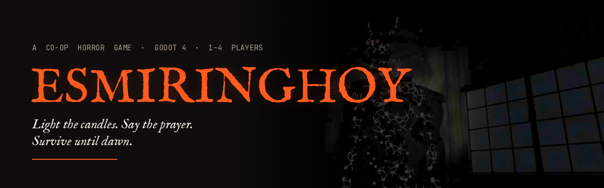
</p>

<p align="center">
  <b>A first-person co-op horror game set in a Filipino ancestral house.</b><br>
  Made with Godot 4 and GDScript.
</p>

<p align="center">
  
  
  
  
  
</p>

> [!IMPORTANT]
> **Esmiringhoy is still in testing.** It is not released or deployed on any game store (itch.io, Steam or others) yet.
> I'm using this project to learn how multiplayer networking really works in Godot: hosting, joining, and keeping every player's game in sync. Expect bugs, especially in **animations** and in how game events are **relayed between players** in co-op.
> You can still watch the [trailer](#trailer) and browse the [screenshots](#screenshots) below to see what the game is about.

---

## Trailer

<p align="center">
  <a href="media/esmiringhoy_trailer.mp4">
    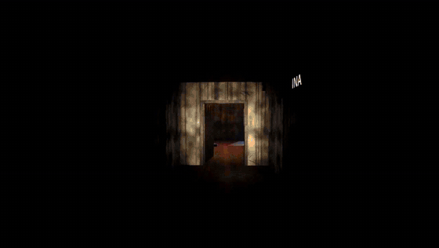
  </a>
  <br>
  <sub>▶ Click the preview for the full 61-second trailer (<code>media/esmiringhoy_trailer.mp4</code>). All footage is captured in-game.</sub>
</p>

<!--
  To get GitHub's built-in video player here instead of the GIF:
  edit this README on github.com, drag media/esmiringhoy_trailer.mp4 into the editor,
  and keep the https://github.com/user-attachments/assets/... link it inserts on its own line.
-->

## Content note

Esmiringhoy is a horror game with demonic imagery, jump scares, death (shown off-screen) and Filipino Catholic and folk-belief themes (a wake, prayers, candles). It is not made for children.

**Photosensitivity warning:** the game has flickering lights and a full-screen red flash when you are caught.

## The story

For 139 years the Villareal family has paid for its fortune by keeping a demon asleep under their house. The last keeper, Lola Remedios, has just died. On the third night of her *lamay* (wake), during a typhoon, the candles around her coffin go out on their own, and the **Esmiringhoy** wakes.

You and your cousins are trapped inside Casa Villareal, a *bahay na bato* built in 1878. Lola left you one way out: light the blessed candles in the old *oratorio*, say the prayer, and end the bargain before dawn. If it catches you, you become one of its children.

> *Your lola kept it asleep for sixty years. Tonight it is your turn, and keeping it is not enough. You have to finish it.*

The full lore, characters, notes, prayer and endings are in [`docs/ESMIRINGHOY_STORY.md`](docs/ESMIRINGHOY_STORY.md).

## Screenshots

| | |
|:---:|:---:|
| 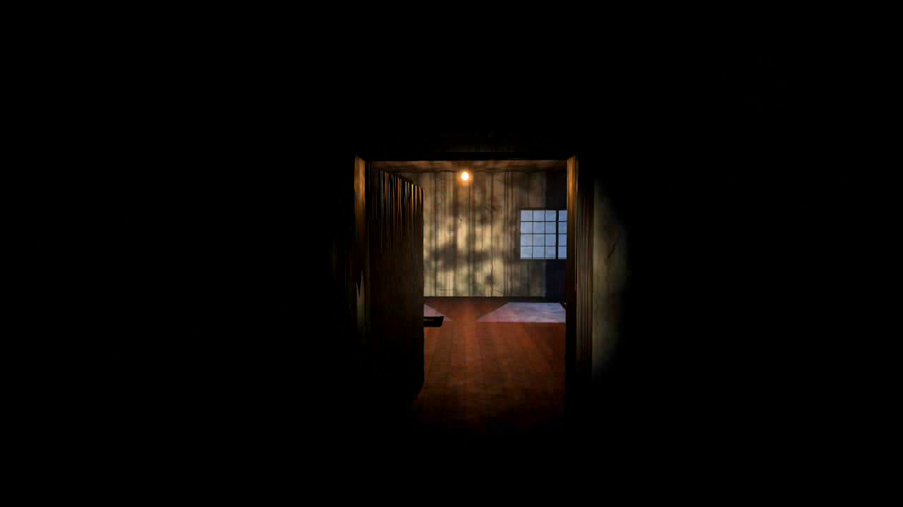 | 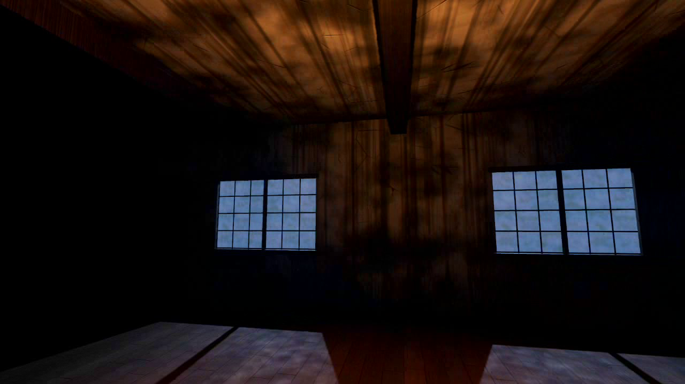 |
| *The corridor* | *Capiz moonlight* |
| 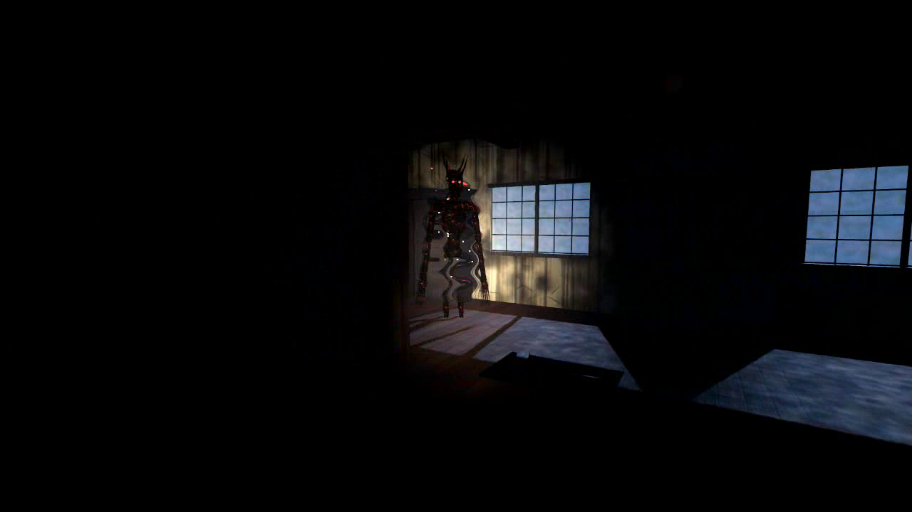 | 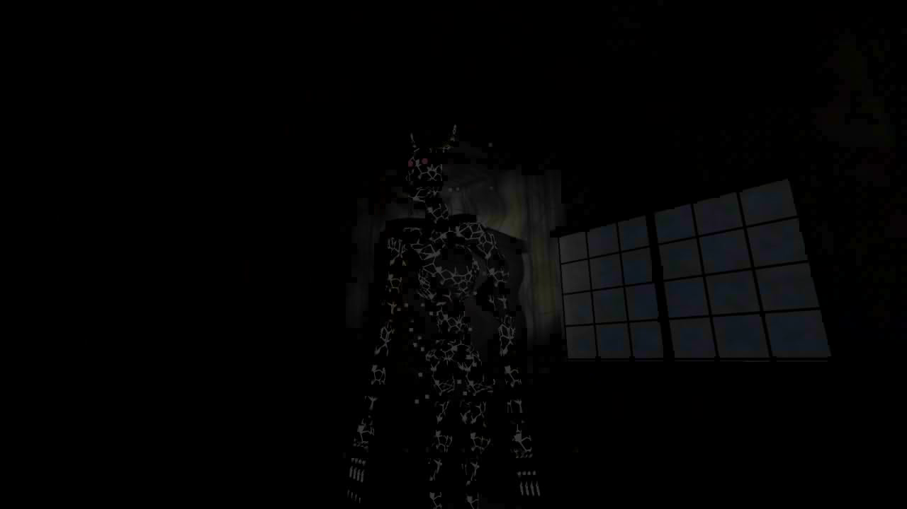 |
| *It is awake* | *Frozen in the beam* |
| 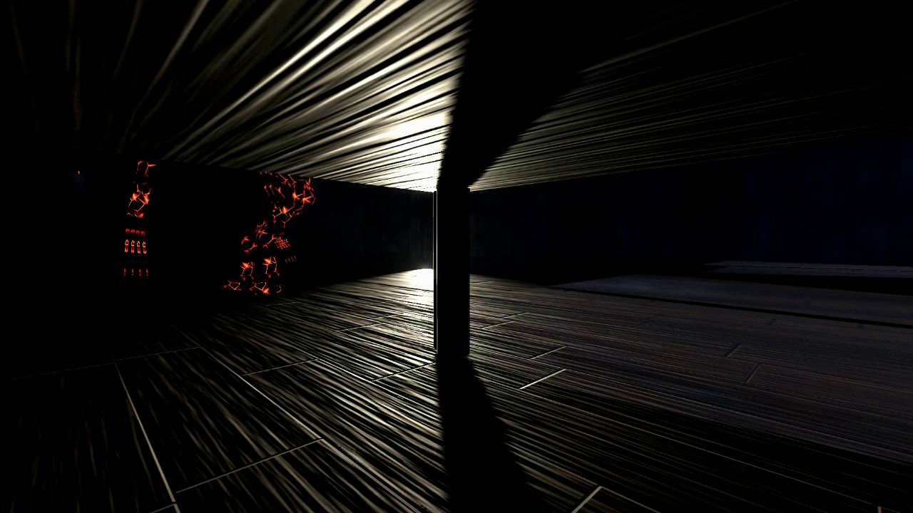 | 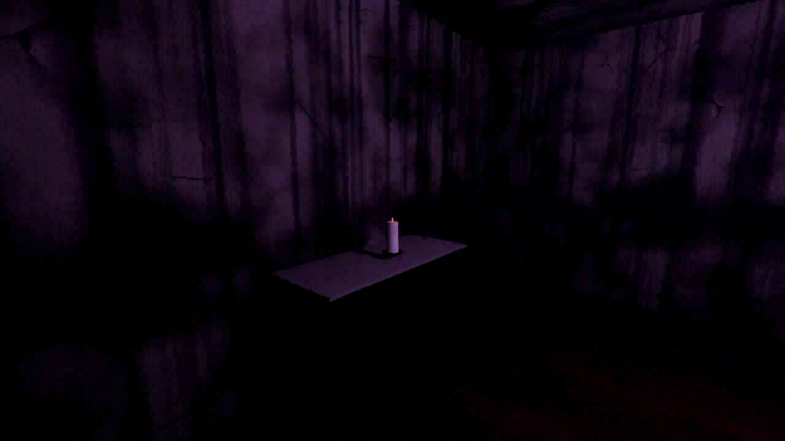 |
| *Hiding under the bed* | *The oratorio candle* |
| 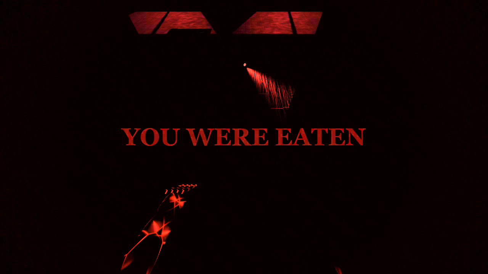 | 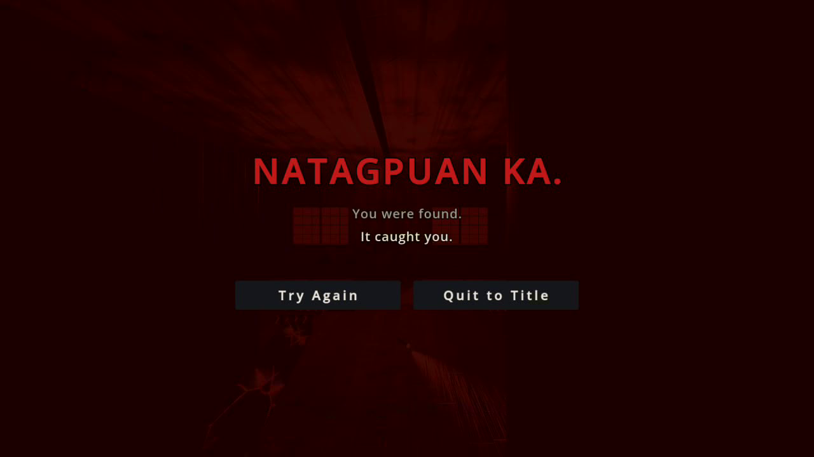 |
| *You were eaten* | *Natagpuan ka. (You were found.)* |

<details>
<summary>More screenshots</summary>

| | |
|:---:|:---:|
| 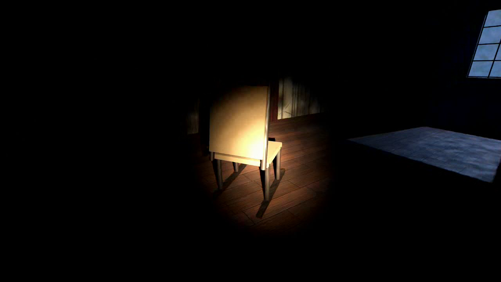 | 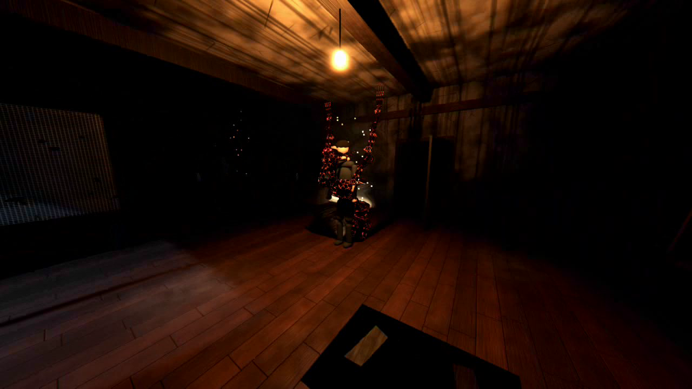 |
| *The tumba-tumba rocks when it's near* | *It comes closer* |

</details>

## Features

- **A hunter that listens.** Running is loud and draws it in. Walking is quieter, and crouching is almost silent. You hear it too: its footsteps and rumble are positional, so play with headphones.
- **Hide and hold your breath.** Climb into a bed, *aparador* (wardrobe), table, cabinet, clay jar or curtain. If it sees you go in, it will look there. When it searches nearby, hold your breath before your lungs give out.
- **A flashlight that saves and betrays you.** Holding the beam on it freezes it for a few seconds, but drains the battery fast and shows it where you are.
- **Distract it.** Throw rocks, set off the sala radio, the CR pipes or Tomasito's music box, then slip away while it investigates.
- **Room lights.** Five rooms have a light switch. A lit room drives it out for a while, then the fuse needs time to cool down.
- **Different every run.** The ritual candles, matches, blessed salt and oratorio key spawn in different rooms each game.
- **The house warns you.** The bulb dies, the rocking chair moves and the *kulambo* (mosquito net) sways when it's close.
- **Getting caught** plays a full death sequence: *You were eaten*, then *Natagpuan ka*.
- **LAN co-op for up to 4 players**, plus a solo mode with three difficulties (Easy, Normal, Nightmare).
- **Procedural assets.** All textures and sounds are generated by the Python scripts in [`tools/`](tools).

## How to play

**Goal:** find the **matches**, the **blessed salt** and the **oratorio key**. Light the candles hidden around the house, open the oratorio (the chapel), and light the last candle on its altar to banish the Esmiringhoy.

- A lit candle makes a small **safe zone** it won't enter.
- The matches light every candle except the last one, which needs the blessed salt.
- Press **J** or **Tab** to open the journal and see your objectives.

### Controls

| Key | Action |
|---|---|
| `W` `A` `S` `D` | Move |
| Mouse | Look around |
| `Shift` | Run (loud) |
| `Ctrl` / `C` | Crouch |
| `F` | Flashlight on / off |
| `Q` | Throw a rock to distract it |
| `E` (hold) | Light a candle |
| `E` | Enter or leave a hiding spot · flip a light switch · set off a lure |
| `Space` | Hold your breath while hidden · jump while moving |
| `J` / `Tab` | Journal |
| `Esc` | Pause, settings and controls |
| `R` | Restart after the round ends |

## Running the game

**Requirements:** [Godot 4.7](https://godotengine.org/download) (standard build, not .NET). The game uses the Forward+ renderer, so you need a Vulkan-capable GPU.

1. Clone the repository:
   ```bash
   git clone https://github.com/<your-username>/Esmiringhoy.git
   ```
2. Open Godot, choose **Import**, and select `project.godot`.
3. Press **F5**. The game opens on the lobby (`scenes/lobby.tscn`).

The first import takes a moment while Godot imports the textures, sounds and fonts.

### Co-op (LAN)

1. One player chooses **Host Co-op (LAN)**. The lobby shows the address to share.
2. The others choose **Join Co-op (LAN)** and enter that address.
3. Everyone needs to be on the same network. The game uses **UDP port 24567**, so allow Godot (or the exported game) through the Windows firewall when it asks.

Up to 4 players. The host runs the Esmiringhoy's AI.

**Privacy:** the game collects no personal data and sends nothing to the internet. Settings are saved only on your computer (`user://settings.cfg`). In LAN co-op, players' computers exchange IP addresses and in-game positions directly with each other. Internet play (UPnP and room codes) is planned. See [`docs/ESMIRINGHOY_DEPLOY_MULTIPLAYER_BRIEF.md`](docs/ESMIRINGHOY_DEPLOY_MULTIPLAYER_BRIEF.md).

## Project structure

```
project.godot
scenes/
  lobby.tscn            title / lobby (main scene)
  main.tscn             the game
scripts/
  ui.gd                 shared theme: palette, fonts, buttons (autoload Ui)
  settings.gd           saved settings (autoload Settings)
  game.gd               difficulty and end-of-round stats (autoload Game)
  net.gd                ENet LAN host / join (autoload Net)
  end_screen.gd         win / death screens (autoload EndScreen)
  settings_panel.gd     settings overlay (autoload SettingsPanel)
  journal.gd            in-game journal and objectives (autoload Journal)
  lobby.gd              title menu, difficulty, host / join
  main.gd               game flow, item and candle spawns, catch sequence, win
  room.gd               builds the house from code (@tool, visible in the editor)
  player.gd             first-person controller, flashlight, crouch, hiding, breath
  player_body.gd        other players' bodies in co-op
  demon.gd              the Esmiringhoy's AI: patrol, listen, hunt, search, catch
  demon_body.gd         the demon's procedural body and animation
  candle.gd             ritual candles and their safe zones
  item.gd, pickup.gd    quest items and battery pickups
  hiding_spot.gd        beds, wardrobes, jars and other hiding places
  light_switch.gd       room lights with fuse cooldown
  noisemaker.gd         lures (radio, pipes, music box)
  hud.gd, pause.gd      HUD and pause menu
assets/
  textures/             procedurally generated PBR textures
  audio/                synthesized sound effects and ambience
  shaders/              demon skin, capiz glass, heat shimmer, catch overlay
  fonts/                IM Fell English, Inter, JetBrains Mono (SIL OFL)
tools/                  Python generators for the textures and audio
trailer/                Movie Maker scene that records the trailer
docs/                   story, gameplay brief, deploy and multiplayer brief
media/                  README images and trailer (ignored by Godot)
```

## Regenerating the assets

```bash
pip install numpy scipy pillow     # ffmpeg must also be on your PATH for the audio
python tools/gen_textures.py .
python tools/gen_audio.py .
```

## Recording the trailer

The trailer is rendered by the game itself with Godot's Movie Maker mode, so it always shows the current build.

- **Windows:** edit the Godot path at the top of `record_trailer.bat`, then run it. The video is written to `trailer_out/esmiringhoy_trailer.ogv`.
- **Manually:**
  ```bash
  godot --path . --write-movie trailer_out/esmiringhoy_trailer.ogv --fixed-fps 30 res://trailer/trailer.tscn
  ```
- Convert to MP4 for YouTube or itch.io:
  ```bash
  ffmpeg -i trailer_out/esmiringhoy_trailer.ogv -c:v libx264 -crf 18 -pix_fmt yuv420p -c:a aac -b:a 192k -movflags +faststart esmiringhoy_trailer.mp4
  ```

See [`trailer/README.txt`](trailer/README.txt) for details.

## Documentation

| Document | What it covers |
|---|---|
| [`docs/ESMIRINGHOY_STORY.md`](docs/ESMIRINGHOY_STORY.md) | Lore, characters, notes, the Oración and the endings |
| [`docs/ESMIRINGHOY_GAMEPLAY_BRIEF.md`](docs/ESMIRINGHOY_GAMEPLAY_BRIEF.md) | Gameplay design and the plan for the full house |
| [`docs/ESMIRINGHOY_DEPLOY_MULTIPLAYER_BRIEF.md`](docs/ESMIRINGHOY_DEPLOY_MULTIPLAYER_BRIEF.md) | Export presets, itch.io with butler, UPnP, lobby and noray room codes |
| [`docs/ASSET_LICENSES.md`](docs/ASSET_LICENSES.md) | Where every font, texture, sound and image comes from, and its license |
| [`docs/COMPLIANCE_AUDIT.md`](docs/COMPLIANCE_AUDIT.md) | Release checklist results: licensing, notices, claims, privacy, multiplayer security |

## Roadmap

The game is in testing, so this list is what comes before any store release.

- [ ] Fix animation bugs and co-op sync issues found in testing
- [ ] Export presets and a Windows build on itch.io
- [ ] Caught players turn into lesser demons and hunt the others
- [ ] Internet co-op: UPnP and noray room codes
- [ ] The full Casa Villareal (zaguan, bodega, sala, oratorio) from the story
- [ ] Match the lighting, fog and demon to the concept art

## Credits

- **Created by** Danniel Canary Quipia
- **Engine:** [Godot Engine](https://godotengine.org) 4.7, written in GDScript
- **Development tools:** OpenCode, Freebuff and Claude Code (AI-assisted development)
- **Textures and sounds:** generated procedurally by the scripts in `tools/`
- **Asset sources and licenses:** see [`docs/ASSET_LICENSES.md`](docs/ASSET_LICENSES.md)
- **Fonts:** [IM Fell English](https://fonts.google.com/specimen/IM+Fell+English) (Igino Marini), [Inter](https://rsms.me/inter/) (Rasmus Andersson) and [JetBrains Mono](https://www.jetbrains.com/lp/mono/) (JetBrains), all under the SIL Open Font License. See [`assets/fonts/licenses`](assets/fonts/licenses).

## License

No license has been chosen yet, so all rights are reserved by the author for now. The bundled fonts keep their own SIL Open Font License.

Godot Engine is MIT-licensed. Builds of this game must include Godot's license notice (see the [Godot license page](https://godotengine.org/license/)).
